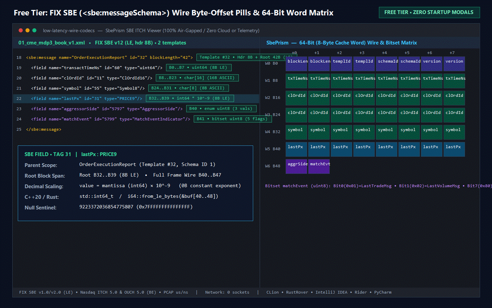

# SbePrism SBE ITCH Viewer — Offline FIX SBE, Nasdaq ITCH/OUCH & PCAP Wire Inspector for JetBrains IDEs

[-087CFA)](https://ediprism.github.io/)

**Deterministic, 100% offline / air-gapped low-latency binary market-data and order-entry wire inspector for `FIX Simple Binary Encoding` (`<sbe:messageSchema>` XML / `.sbe`), `Nasdaq TotalView-ITCH 5.0 & OUCH 5.0` (`.itch`, `.ouch`), and raw packet captures (`.pcap`, `.pcapng`, `.sbedata`, `.sbehex`) featuring inline wire byte-offset pills, an interactive `64-bit Wire Word & Bitset Layout Matrix`, schema evolution validator, semantic `Ctrl+D` diff, zero-copy `C++20 / #[no_std] Rust` codec generator, and `HmacSHA256` firm/account scrubber across all JetBrains IDEs** (`CLion`, `RustRover`, `IntelliJ IDEA`, `Rider`, `PyCharm`, `DataGrip`, `GoLand`, `WebStorm`).

Built for HFT, quantitative trading, exchange matching-engine, smart-order-router, and institutional fintech engineers barred by **SEC / FINRA / MiFID II rules and proprietary alpha protection** from uploading production `.pcap` packet captures, `ClOrdID`s, or internal SBE XML schemas into browser parsers or cloud AI tools.

- **100% Local & Air-Gapped:** Zero backend servers, zero databases, zero telemetry, zero cloud or LLM API calls, zero native `libpcap` DLL dependencies.
- **Zero-Hijack XML Support:** Automatically activates on `<sbe:messageSchema>` `.xml` and `.sbe` files while leaving standard project XML (`pom.xml`, `logback.xml`, etc.) completely untouched.

---

## Free Tier vs. `[Pro]` Feature Matrix

| Capability | Free Tier | `[Pro]` Tier (14-Day Free Trial) |
| :--- | :---: | :---: |
| **Zero-Hijack `<sbe:messageSchema>` XML & `.sbe` Inline Wire Byte-Offset Pills (`B0..B7 • uint64 LE`)** | Yes | Yes |
| **Hover Cards (C++20 / Rust Types, Null Sentinels, `mantissa * 10^exponent` Decimals, `<set>` Bitmasks)** | Yes | Yes |
| **Interactive 2D `64`-Bit (`8`-Byte Word) Wire & Bitset Layout Matrix + Editor Caret Sync** | Yes | Yes |
| **Built-In Clean-Room `Nasdaq TotalView-ITCH 5.0` & `OUCH 5.0` Wire Catalogs + SpeedSearch** | Yes | Yes |
| **Zero Startup Nag Modals** | Yes | Yes |
| **Offline `.pcap` / `.pcapng` (Microsecond & Solarflare/Exablaze Nanosecond), `CME MDP 3.0`, `MoldUDP64` & `ITCH 5.0` Binary Wire Decoder** | — | **Yes** |
| **SBE Wire-Ordering (`Root -> Groups -> VarData`), Alignment Gap, Overlap & `blockLength` Validator** | — | **Yes** |
| **Semantic `<sbe:messageSchema>` Evolution Diff (`Alt+Shift+B` & Native `Ctrl+D`) Flagging Breaking Offset/Type Shifts** | — | **Yes** |
| **1-Click Zero-Copy `C++20 (.hpp)`, `#[no_std] Rust (.rs)`, Unit-Test Byte Vectors & `HmacSHA256` Alpha Scrubber (`Alt+Shift+R`)** | — | **Yes** |

---

## Low-Latency Quant Engineering Guides

- **[FIX SBE Wire Byte-Offset Calculation, Alignment Padding Gaps, `actingBlockLength`, and Safe `sinceVersion` Evolution](./guides/fix-sbe-wire-byte-offset-alignment-and-evolution.md)**
- **[Decoding `Nasdaq TotalView-ITCH 5.0` & `MoldUDP64` Packets: 48-Bit Midnight Nanosecond Timestamps & `Price4` Scaling](./guides/nasdaq-itch-50-moldudp64-48bit-timestamp-decoding.md)**

---

## Sister Plugins in the EdiPrism Air-Gapped Suite

- **[EdiPrism X12 EDIFACT (`#35990`)](https://plugins.jetbrains.com/plugin/35990-ediprism-x12-edifact):** 100% offline `ASC X12` & `UN/EDIFACT` loop inspector, `999` pinpointer, semantic diff, balancing validator, and HIPAA scrubber ([GitHub Docs](https://github.com/EdiPrism/ediprism)).
- **[EbcdicPrism Copybook Viewer (`#36104`)](https://plugins.jetbrains.com/plugin/36104-ebcdicprism-copybook-viewer):** 100% offline `COBOL Copybook` (`.cpy`), binary `EBCDIC` / `COMP-3` record overlay, `S0C7` validator, and `PCI-DSS` binary scrubber ([GitHub Docs](https://github.com/EdiPrism/ebcdicprism)).
- **[CanPrism DBC ARXML Viewer (`#36115`)](https://plugins.jetbrains.com/plugin/36115-canprism-dbc-arxml-viewer):** 100% offline `CAN / CAN FD` (`.dbc`), `AUTOSAR` (`.arxml`), and `SAE J1939` 64-bit Motorola/Intel bit matrix, `candump`/`.asc` decoder, and `C99` codegen ([GitHub Docs](https://github.com/EdiPrism/canprism)).

---

## Legal, Privacy & Support

- **Privacy & Air-Gapped Security Attestation:** [PRIVACY.md](./PRIVACY.md) • [ediprism.github.io/privacy.html](https://ediprism.github.io/privacy.html)
- **End-User License Agreement (EULA):** [EULA.md](./EULA.md) • [ediprism.github.io/eula.html](https://ediprism.github.io/eula.html)
- **Release Notes:** [CHANGELOG.md](./CHANGELOG.md)
- **Bug Reports & Feature Requests:** [GitHub Issues](https://github.com/EdiPrism/sbeprism/issues) • [Support Hub](https://ediprism.github.io/support.html)

*FIX and Simple Binary Encoding (SBE) are trademarks or specifications of FIX Protocol Limited. Nasdaq, TotalView-ITCH, and OUCH are trademarks of Nasdaq, Inc. CME is a trademark of Chicago Mercantile Exchange Inc. SbePrism is an independent clean-room developer tool by EdiPrism and is not affiliated with, endorsed by, or sponsored by FIX Protocol Limited, Nasdaq, Inc., CME Group Inc., or JetBrains s.r.o.*
